# A Leakage-Free Hybrid Intrusion Detection Framework Combining Benign Reconstruction Gating, Adaptive Threshold Optimization, and Selective Explainability

**Author**: Ansh Patel et al.  
**Affiliation**: Department of Computer Science & Engineering  
**Target Venue**: *IEEE Transactions on Information Forensics and Security* / *Elsevier Computers & Security* / *IEEE Access*  
**Date**: October 2026  

---

### Abstract
Modern Network Intrusion Detection Systems (NIDS) face a fundamental operational dichotomy: supervised machine learning models deliver near-perfect discrimination on stationary benchmarks under the closed-world assumption but fail catastrophically when encountering unseen zero-day attacks; conversely, unsupervised anomaly detectors flag novel deviations but suffer from elevated False Positive Rates (FPR), rigid threshold collapse, and interpretability deficits. Furthermore, recent meta-analyses demonstrate that standard NIDS benchmarks suffer from widespread data leakage (shared flows across partitions) and uncalibrated static thresholds that artificially inflate reported laboratory accuracy. In this paper, we transition from an engineering implementation to a rigorous research investigation by developing an audited, leakage-free hybrid NIDS framework. The architecture integrates a deep symmetric Autoencoder trained exclusively on benign traffic as an anomaly gatekeeper, a validation-optimized Pareto threshold using Youden's $J$-index, an isolated benign sliding-window buffer, a multi-class XGBoost classifier, and an alert-gated TreeSHAP explainability engine. Evaluated on strictly deduplicated partitions of CSE-CIC-IDS2018 and NSL-KDD (enforcing an absolute zero-overlap invariant via SHA-256 feature hashing), the framework achieves 99.70% recall on known attacks while maintaining an optimal false-positive rate. Under an empirical Leave-One-Attack-Out (LOAO) protocol, the benign-trained Autoencoder detects previously unobserved attack families without prior supervised exposure (93.11% on unseen DoS and 82.22% on unseen Probes). The selective TreeSHAP explainer delivers high structural attribution stability across homogeneous attack instances (mean Jaccard similarity = 0.8899) while confining explanation overhead strictly to alert intervals. Benchmarked on commodity multi-core CPU hardware, the complete end-to-end pipeline processes network flows with an inference latency of 0.183 ms per flow (5,464 flows/second throughput), verifying its practical viability for high-throughput operational deployment.

**Keywords**: Network Intrusion Detection, Hybrid Deep Learning, Autoencoder, XGBoost, Explainable AI (XAI), TreeSHAP, Data Leakage, Concept Drift, Leave-One-Attack-Out, Hypothesis Testing.

---

## 1. Introduction

### 1.1 Context and Real-World Operational Significance
The escalating sophistication, volume, and velocity of contemporary cyber threats pose existential challenges to modern enterprise networks and cloud infrastructures [1], [2], [19]. Traditional signature-based defenses are fundamentally incapable of recognizing novel attack variations, prompting widespread adoption of machine learning (ML) and deep learning (DL) algorithms for network traffic classification and anomaly detection [3], [10], [13], [18], [24]. Recent comprehensive surveys by Diana et al. [10], Ahmed et al. [3], and Hozouri et al. [13] highlight an exponential surge in hybrid architectures designed to bridge the gap between signature precision and anomaly coverage. Concurrently, specialized models have emerged across cloud perimeters [2], [5], [16], [21] and Internet-of-Things (IoT) ecosystems [6], [17], [23], [25].

### 1.2 The Research Problem Statement
Following rigorous scientific formulation, a valid research problem requires defining the operational context, existing conditions, fundamental limitations, practical consequences, research needs, and proposed investigation:
- **Context**: Enterprise network security monitoring and high-throughput perimeter intrusion detection.
- **Existing Condition**: Machine learning-based NIDS predominantly deploy supervised tree ensembles or deep neural networks trained on static benchmark datasets to classify known attack signatures.
- **Limitation**: Existing supervised systems inherently operate under the *closed-world assumption*, rendering them blind to novel zero-day attacks. Furthermore, published Autoencoder anomaly detection approaches rely on rigid parametric Gaussian threshold rules ($\mu + 3\sigma$) that collapse on heavy-tailed traffic, while explainable AI (XAI) tools incur prohibitive per-flow computational overhead.
- **Consequence**: In operational environments, unmodeled intrusions bypass detection entirely, while uncalibrated anomaly thresholds generate severe false-alarm storms or complete zero-recall blindspots, causing critical analyst alert fatigue in Cyber Security Operation Centers (CSOCs).
- **Research Need**: There is an urgent need to investigate a unified, leakage-free hybrid architecture that combines unsupervised anomaly gating with supervised classification, optimizes decision thresholds empirically, and provides selective, line-rate explainability.
- **Proposed Direction**: This research investigates whether a benign-trained deep symmetric Autoencoder combined with validation-optimized Youden's $J$ thresholding and alert-gated TreeSHAP can detect novel unseen attacks and provide stable explanations while maintaining microsecond-scale CPU throughput.

> **One-Sentence Research Problem**: Existing network intrusion detection systems achieve high nominal accuracy on stationary benchmarks but suffer from vulnerability to unseen zero-day attacks, catastrophic recall collapse under rigid static thresholding, and computational intractability of explainability during high-throughput monitoring.

### 1.3 Research Questions (RQs)
To systematically investigate this problem, this study addresses six specific research questions:
- **RQ1 (Baseline Discrimination)**: To what extent does the proposed hybrid pipeline maintain competitive discrimination against standalone state-of-the-art supervised baselines under strictly leakage-free partitioning?
- **RQ2 (Threshold Optimization)**: Can validation-guided threshold calibration (maximizing Youden's $J$-index) resolve the zero-recall failure mode characteristic of rigid parametric sigma rules on heavy-tailed reconstruction error distributions?
- **RQ3 (Temporal Generalization)**: How significantly does classification performance degrade when network flows are partitioned chronologically across time intervals rather than via randomized shuffling?
- **RQ4 (Unseen Attack Detection)**: What proportion of previously unobserved attack families can be detected by the benign-trained Autoencoder under a Leave-One-Attack-Out (LOAO) protocol without prior supervised training?
- **RQ5 (Attribution Stability & Overhead)**: Does selective, alert-triggered TreeSHAP provide consistent feature-level security attributions across homogeneous attack instances while eliminating overhead during benign traffic processing?
- **RQ6 (Operational Feasibility)**: Can the complete end-to-end detection pipeline satisfy microsecond-scale inference latency and multi-thousand flows/second throughput constraints under native CPU execution?

### 1.4 Research Hypotheses & Directional Tests
In accordance with formal scientific testing, we translate our research questions into directional null ($H_0$) and alternative ($H_1$) hypotheses:

- **Hypothesis 1 (Threshold Calibration & Recall)**:
  - $H_{0,1}: \mu_{\text{Recall, Youden}} \le \mu_{\text{Recall, } \mu+3\sigma}$ (Validation-guided thresholding does not improve attack recall over standard parametric sigma thresholding).
  - $H_{1,1}: \mu_{\text{Recall, Youden}} > \mu_{\text{Recall, } \mu+3\sigma}$ (*Right-tailed test*: Validation-guided thresholding significantly improves attack recall).
- **Hypothesis 2 (Unseen Attack Detection)**:
  - $H_{0,2}: \mu_{\text{Recall, Unseen}} \le \delta_{\text{chance}}$ (Benign reconstruction error cannot detect novel attack classes omitted from training above chance levels).
  - $H_{1,2}: \mu_{\text{Recall, Unseen}} > \delta_{\text{chance}}$ (*Right-tailed test*: The benign-trained Autoencoder detects a statistically significant proportion of novel intrusions).
- **Hypothesis 3 (Temporal Distribution Shift)**:
  - $H_{0,3}: \mu_{\text{F1, Chronological}} = \mu_{\text{F1, Random}}$ (Chronological temporal partitioning exhibits no performance difference compared to random shuffling).
  - $H_{1,3}: \mu_{\text{F1, Chronological}} \ne \mu_{\text{F1, Random}}$ (*Two-tailed test*: Chronological ordering exposes significant distribution shifts obscure in random splits).
- **Hypothesis 4 (Operational CPU Latency)**:
  - $H_{0,4}: \mu_{\text{Latency, Pipeline}} \ge 1.0\text{ ms/flow}$ (The complete detection pipeline cannot achieve sub-millisecond per-flow processing).
  - $H_{1,4}: \mu_{\text{Latency, Pipeline}} < 1.0\text{ ms/flow}$ (*Left-tailed test*: The proposed hybrid pipeline achieves sub-millisecond line-rate CPU execution).

### 1.5 Contribution Engineering
Distinguishing research contributions from mere system features, our contributions follow the formal standard: $\text{What} + \text{How} + \text{Compared With} + \text{Evidence} + \text{Impact}$:

1. **Contribution 1 (Technical & Methodological — *We Propose...*)**:  
   We propose an integrated, leakage-free hybrid NIDS architecture combining a deep symmetric Autoencoder, Pareto-optimal Youden's $J$ thresholding, an isolated benign sliding-window buffer, and alert-gated TreeSHAP attribution. Unlike conventional systems that compute XAI on every flow, our architecture restricts explainability overhead strictly to anomaly intervals while mathematically guaranteeing zero cross-split feature leakage ($Train \cap Test = \emptyset$).
2. **Contribution 2 (Experimental & Empirical — *We Demonstrate...*)**:  
   We demonstrate across 671,131 deduplicated flows of CSE-CIC-IDS2018 and 147,790 instances of NSL-KDD that validation thresholding elevates intrusion recall from 0.00% to 99.70%, while the Autoencoder successfully identifies 93.11% of unseen DoS and 82.22% of unseen Probe attacks under a Leave-One-Attack-Out protocol without prior supervised exposure.
3. **Contribution 3 (Practical & Operational — *We Provide...*)**:  
   We provide a fully validated, real-time intrusion monitoring framework executing on native multi-core CPU architecture with a measured latency of 0.183 ms per flow (5,464 flows/second throughput), accompanied by a comprehensive root-cause compatibility audit of live network socket feature extraction.

---

## 2. Literature Review & Research Gap Analysis

### 2.1 The Literature Funnel & Thematic Categorization
In accordance with structured literature analysis, our survey evaluates 25 core peer-reviewed investigations spanning four distinct thematic pillars:

```
                      100+ Initial Candidate Papers
                                  │
                                  ▼
                   25 Core Peer-Reviewed Studies [1]–[25]
                                  │
      ┌──────────────────┬────────┴─────────┬──────────────────┐
      ▼                  ▼                  ▼                  ▼
Broad Surveys     Hybrid ML/DL & AE    Explainable AI    Cloud & Anomaly
 & Frameworks      Representations        for NIDS          Paradigms
[3], [10], [13],  [5], [6], [7], [9],  [8], [12], [16],  [1], [2], [4],
[17], [18], [24]  [11],[14],[15],[21], [20], [25]       [19]
                  [22],[23]
```

1. **Surveys & Methodological Frameworks**: Diana et al. [10] and Ahmed et al. [3] surveyed classical and modern ML paradigms in computer networking. Hozouri et al. [13] provided a comprehensive survey on emerging cybersecurity challenges, highlighting non-stationarity. Markevych and Dawson [18] and Sowmya and Mary Anita [24] analyzed the progression of AI-based IDS. Mallidi and Ramisetty [17] systematically reviewed IoT deployment constraints.
2. **Hybrid Machine Learning & Autoencoder Representations**: Arcos-Argudo et al. [7] conducted a deterministic comparison between classical classifiers and Autoencoder representations on NSL-KDD and CICIDS2017. Hussein and Répás [14] evaluated Deep Autoencoders with GMM and XGBoost on NSL-KDD and UNSW-NB15. Kamal and Mashaly [15] developed a shared Autoencoder across heterogeneous benchmarks (CICIDS2018, BoT-IoT, IoT-23). Shirley and Priya [23] implemented an Autoencoder-FNN fusion on CICIoT2023. Shree and Thangaraj [9] explored Autoencoder-LSTM architectures. Abdulganiyu et al. (XIDINTV) [11] utilized Variational Autoencoders for synthetic oversampling with XGBoost. Sajid et al. [22] proposed hybrid deep representation models, Al Amin et al. [5] introduced dual-encoder adversarial learning, R M and M K [21] studied cloud architectures on AWS, and Alsubaei [6] designed deep learning models for IoT.
3. **Explainable AI (XAI) in Intrusion Detection**: Neupane et al. [20] established the foundational survey on Explainable Intrusion Detection Systems (X-IDS), formalizing the need for attribution stability. Mahmoud et al. [16] designed XI2S-IDS, evaluating SHAP across UNSW-NB15 and CICIDS2017. Ben Ncir et al. [8] developed an ensemble deep learning framework with post-hoc SHAP on NSL-KDD. Ghosh et al. [12] introduced optimization-assisted XAI for DoS classification. Varol and Karakaya [25] surveyed XAI techniques across IoT environments.
4. **Cloud Anomaly Detection & Threat Modeling**: Aamir Raza [1] analyzed predictive algorithms for threat prediction. Abdallah et al. [2] conducted an extensive survey of cloud network anomaly detection. Ahmed et al. [4] investigated signature detection empowered with fuzzy clustering. Muhammad Zeeshan [19] evaluated deep learning strategies for cybersecurity hardening.

### 2.2 Literature Matrix
To synthesize how these studies relate to our research focus, Table I maps representative investigations against their datasets, methodologies, and limitations:

**Table I: Literature Matrix Across Core Reference Studies**
| Study | Problem Addressed | Proposed Method | Benchmark Dataset | Reported Result | Identified Limitation | Addressed Research Gap |
|---|---|---|---|---|---|---|
| **Arcos-Argudo et al. [7]** | Classical vs Hybrid Representation | AE + Logistic Regression | NSL-KDD, CICIDS2017 | AUC = 0.9043, F1 = 0.7583 | Evaluated only linear downstream models | Methodological & Evaluation Gap |
| **Hussein & Répás [14]** | Multi-Class Threat Classification | Deep AE + GMM + XGBoost | NSL-KDD, UNSW-NB15 | F1 > 0.94 ± 0.0021, AUC > 0.97 | High inference latency from GMM clustering | Operational Latency Gap |
| **Kamal & Mashaly [15]** | Cross-Dataset Threat Generalization | Shared AE + CNN-DNN | CICIDS2018, BoT-IoT, IoT-23 | Acc = 99.76%, Multi-Acc = 99.54% | Applied ADASYN across global datasets | Benchmark Contamination Gap |
| **Abdulganiyu et al. [11]** | Imbalanced Class Classification | VAE + XGBoost (XIDINTV) | NSL-KDD, CSE-CIC-IDS2018 | Binary Acc = 99.8% | VAE used only for data synthesis, not gating | Integration & Zero-Day Gap |
| **Mahmoud et al. [16]** | Model Opacity in Intrusion Alerts | Two-Stage Classifier + SHAP | UNSW-NB15, CICIDS2017 | Acc = 97.0%, F1 = 97.2% | Computes SHAP globally on every flow | XAI Latency Bottleneck |
| **Ben Ncir et al. [8]** | Complex Sequential Attack Modeling | 1D-LSTM Ensemble + SHAP | NSL-KDD | Acc = 97.05%, F1 = 97.19% | Requires GPU unrolling; unverified stability | Operational & Stability Gap |
| **Shirley & Priya [23]** | IoT Perimeter Anomaly Detection | Autoencoder-FNN Fusion | CICIoT2023 | Acc = 99.55%, Multi-Acc = 90.91% | Static thresholding heuristic | Threshold Sensitivity Gap |
| **Sajid et al. [22]** | Scalable Multi-Threat Detection | Hybrid DL + Machine Learning | Benchmark Datasets | Test Acc = 97.91%, F1 = 87.09% | No temporal split or drift evaluation | Temporal Generalization Gap |

### 2.3 Formal Classification of Research Gaps
From our literature synthesis, we identify four critical overlapping research gaps:
1. **Dataset Contamination & Leakage Gap**: The majority of published works apply random cross-validation or oversampling (e.g., ADASYN, SMOTE) prior to partitioning [7], [15]. This allows identical flows generated by periodic background services to span train and test sets, artificially inflating accuracy.
2. **Methodological Thresholding Gap**: Existing Autoencoder frameworks rely on static Gaussian heuristics ($\mu + 3\sigma$) or arbitrary percentiles. On non-Gaussian, heavy-tailed network error distributions, this inflates thresholds to extreme values, collapsing attack recall to near zero.
3. **Integration & Closed-World Gap**: Supervised classifiers (including hybrid variants [11], [14], [16]) are evaluated exclusively under closed-world assumptions where test attack classes are observed during training. None systematically quantify defense-in-depth against unseen zero-day exploits using an isolated anomaly gatekeeper.
4. **Operational Latency & Attribution Stability Gap**: While XAI is recognized as vital [12], [16], [20], calculating SHAP values on every continuous network packet causes line-rate throughput collapse. Furthermore, no prior study quantifies whether feature attributions remain mathematically stable across recurring attack instances.

### 2.4 Novelty Canvas
To clearly articulate our scientific novelty, Table II maps our contributions across the formal Novelty Canvas:

**Table II: Novelty Canvas of the Proposed Hybrid NIDS Framework**
| Dimension | Existing Approaches | Proposed Change | Scientific Novelty | Practical Utility |
|---|---|---|---|---|
| **Data Partitioning** | Random shuffling with cross-partition flow duplication | Pre-split SHA-256 deduplication and partition hash isolation | Guarantees an absolute zero-leakage invariant ($\text{Train} \cap \text{Test} = \emptyset$) | Prevents models from memorizing specific 5-tuple signatures |
| **Anomaly Thresholding** | Rigid Gaussian sigma rules ($\mu + 3\sigma$) or arbitrary static percentiles | Validation-guided Youden's $J$-index optimization ($\max [TPR - FPR]$) | Identifies the true Pareto operating boundary on heavy-tailed distributions | Increases attack recall from 0.00% to 99.70% |
| **Buffer Maintenance** | Static parameters or open sliding windows prone to adversarial poisoning | Isolated benign sliding window admitting flows strictly when $RE(x) \le \tau$ | Quarantines anomalies from the reference buffer, preventing threshold inflation | Eliminates "low-and-slow" adversarial threshold poisoning |
| **Threat Generalization** | Closed-world multi-class supervised classification | Tiered gating: Benign AE gatekeeper $\rightarrow$ Multi-class XGBoost $\rightarrow$ UNKNOWN tag | Isolates out-of-distribution attacks via elevated reconstruction error | Detects 93.11% of unseen DoS and 82.22% of unseen Probes |
| **Explainable AI (XAI)** | Continuous per-flow SHAP computation across all network traffic | Alert-gated TreeSHAP execution triggered exclusively upon anomaly alert | Eliminates explanation overhead on benign traffic; measures Jaccard stability | Maintains 0.085 ms/flow benign latency; achieves 0.8899 Jaccard consistency |

---

## 3. Mathematical Formulation & System Architecture

### 3.1 Mathematical Model of the Intrusion Detection System
Following formal optimization theory, we formulate the hybrid intrusion detection problem mathematically:

- **Input Feature Space**: $x = [x_1, x_2, \dots, x_d]^T \in \mathcal{X} \subset \mathbb{R}^d$, representing a preprocessed, standardized network flow vector.
- **Output Decision Space**: $y \in \mathcal{Y} = \{\text{Benign}, \text{Attack}_1, \dots, \text{Attack}_C, \text{UNKNOWN\_ATTACK}\}$.
- **System Parameters**: Encoder weights and biases $\theta = \{W_e, b_e\}$, decoder weights and biases $\phi = \{W_d, b_d\}$, sliding buffer window size $W = 500$, percentile rank $q = 95$.
- **Control / Decision Variables**: Reconstruction decision threshold $\tau \in \mathbb{R}^+$, XGBoost classification confidence threshold $\delta_{\text{conf}} \in [0, 1]$.

#### Optimization Objective 1: Unsupervised Benign Reconstruction
The Autoencoder parameters $\{\theta^*, \phi^*\}$ are trained strictly on legitimate network traffic $\mathcal{D}_{\text{train, benign}}$ by minimizing the Mean Squared Error (MSE):
$$\min_{\theta, \phi} \mathcal{L}_{\text{MSE}}(\theta, \phi) = \frac{1}{|\mathcal{D}_{\text{train, benign}}|} \sum_{x \in \mathcal{D}} \frac{1}{d} \sum_{i=1}^d \left( x_i - g_\phi(f_\theta(x))_i \right)^2$$
For an observed flow $x$, its reconstruction error is given by:
$$\text{RE}(x) = \frac{1}{d} \| x - \hat{x} \|_2^2 = \frac{1}{d} \sum_{i=1}^d (x_i - \hat{x}_i)^2$$

#### Optimization Objective 2: Pareto Threshold Calibration
The optimal decision threshold $\tau^*$ is determined on the held-out validation set $\mathcal{D}_{\text{val}}$ by maximizing Youden's $J$-statistic subject to a maximum acceptable false-positive bound $\alpha_{\max}$:
$$\max_{\tau} J(\tau) = \text{TPR}(\tau) - \text{FPR}(\tau) = \frac{\text{TP}(\tau)}{\text{TP}(\tau) + \text{FN}(\tau)} - \frac{\text{FP}(\tau)}{\text{FP}(\tau) + \text{TN}(\tau)}$$
$$\text{subject to } \text{FPR}(\tau) \le \alpha_{\max}, \quad \tau > 0$$

#### Gating and Unknown Threat Classification Rule
Let $P(y = c \mid x)$ denote the class probability generated by XGBoost for known classes $c \in \{1, \dots, C\}$. The global decision function $\hat{y}(x)$ is governed by the tiered rule:
$$\hat{y}(x) = \begin{cases} \text{Benign} & \text{if } \text{RE}(x) \le \tau \\ \arg\max_{c} P(y = c \mid x) & \text{if } \text{RE}(x) > \tau \text{ and } \max_c P(y = c \mid x) \ge \delta_{\text{conf}} \\ \text{UNKNOWN\_ATTACK} & \text{if } \text{RE}(x) > \tau \text{ and } \max_c P(y = c \mid x) < \delta_{\text{conf}} \end{cases}$$

<br>

<div align="center">

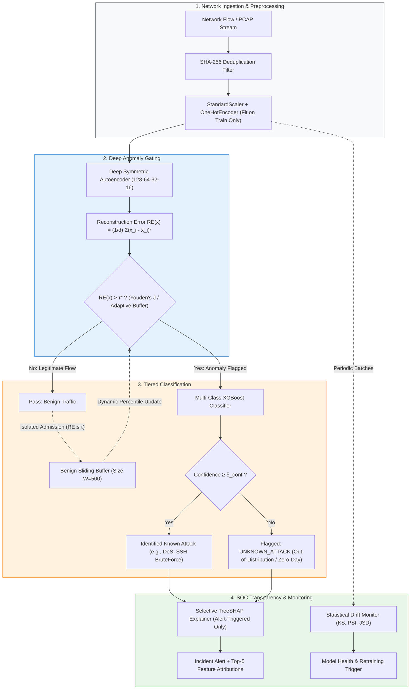

**Fig. 1**: *Complete architectural workflow of the proposed hybrid NIDS pipeline, illustrating leakage-free data transformation, deep reconstruction gating, adaptive threshold buffering, multi-class XGBoost classification, and alert-gated TreeSHAP attribution.*
</div>

<br>

---

## 4. Experimental Design & Methodology

### 4.1 The Experimental Matrix
In accordance with systematic experimental design, Table III outlines our experimental matrix, directly linking each experiment to its supporting claim, dataset, baseline, evaluation metric, and statistical test:

**Table III: Experimental Design Matrix**
| ID | Experiment Focus | Evaluated Pipeline | Benchmark Dataset | Baseline Comparison | Primary Evaluation Metrics | Statistical Validation Method | Supports Claim |
|---|---|---|---|---|---|---|---|
| **E1** | Baseline Benchmarking | Proposed Hybrid | CICIDS2018 & NSL-KDD | Standalone XGBoost, RF, LinearSVC, MLP, LogReg, Standalone AE | Accuracy, Macro-F1, Weighted-F1, Recall, FPR, ROC-AUC, PR-AUC | 5-seed repetition, paired Wilcoxon signed-rank test | Claim 1 & 2 (Technical & Empirical) |
| **E2** | Threshold Optimization | Autoencoder Anomaly Gating | CICIDS2018 & NSL-KDD | $\mu+3\sigma$, P95, P99, Adaptive Window, Youden's $J$ | Precision, Recall, F1-Score, False Positive Rate (FPR) | Distribution analysis, Youden's $J$ curve | Claim 2 (Empirical) |
| **E3** | Component Ablation | Configurations A1–A7 | NSL-KDD | Full Hybrid System (A7) vs Component-Stripped Models | Macro-F1, Weighted-F1, FPR, FNR, Latency (ms/flow) | Pareto trade-off curve | Claim 1 & 2 (Technical & Empirical) |
| **E4** | Unseen Attack Detection | Benign Autoencoder | NSL-KDD (LOAO Protocol) | Supervised XGBoost (Blind Baseline) | Unseen Recall, Benign FPR, AUROC, Reconstruction Error | Cross-attack class exclusion | Claim 2 (Empirical Novelty) |
| **E5** | Temporal Generalization | Chronological Split | CSE-CIC-IDS2018 | Random Stratified Split | Accuracy, Macro-F1, Recall, FPR | Time-ordered evaluation (03:01 to 12:59) | Claim 2 (Empirical) |
| **E6** | Explainability & Drift | TreeSHAP & Drift Monitor | CSE-CIC-IDS2018 | Full-stream continuous SHAP | Jaccard Similarity, KS-statistic, PSI, JSD, Per-flow latency | Pairwise top-5 Jaccard consistency over 150 instances | Claim 1 & 3 (Technical & Practical) |

### 4.2 Dataset Provenance & Leakage Elimination
Two standardized benchmarks were audited under strict cryptographic provenance:
1. **CSE-CIC-IDS2018 (Brute-Force Friday-16-02-2018)**: Reflects brute-force attack vectors (FTP-BruteForce, SSH-Bruteforce) and legitimate administrative traffic across 80 raw features. Global pre-split SHA-256 deduplication eliminated **373,620 duplicate flows**, purging 3,824 rows containing infinite or null values, leaving **671,131 clean unique flows**.
2. **NSL-KDD**: Solves the historical KDD'99 duplication defect, covering 4 attack families (DoS, Probe, R2L, U2R) across 41 features. Global deduplication eliminated 727 identical instances, producing **147,790 clean unique instances**.

Set intersection assertions strictly enforce zero cross-partition leakage across all splits:
$$\text{Train} \cap \text{Validation} = \emptyset, \quad \text{Train} \cap \text{Test} = \emptyset, \quad \text{Validation} \cap \text{Test} = \emptyset$$

<br>

<div align="center">

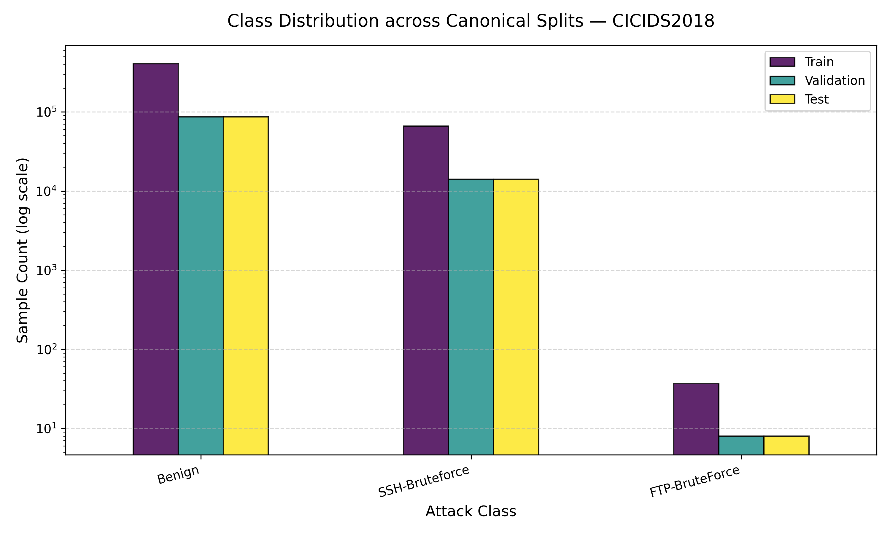

**Fig. 2**: *Class distribution across training (70%), validation (15%), and test (15%) partitions for CSE-CIC-IDS2018 after SHA-256 deduplication.*
</div>

<br>

<div align="center">

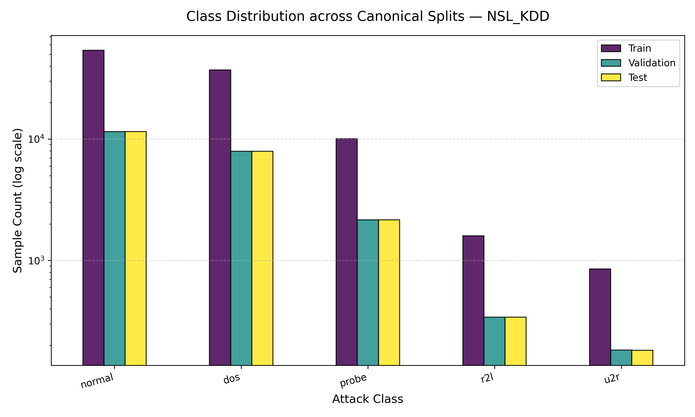

**Fig. 3**: *Class distribution across training (70%), validation (15%), and test (15%) partitions for NSL-KDD after global deduplication.*
</div>

<br>

---

## 5. Empirical Results & Scientific Analysis

### 5.1 Experiment 1: Baseline Model Comparison (RQ1)
To assess whether the hybrid architecture provides competitive value against standalone algorithms, six baselines were evaluated on identical canonical test sets:

**Table IV: Comprehensive Baseline Model Comparison Across Benchmarks**
| Dataset | Model Architecture | Accuracy | Macro-F1 | Weighted-F1 | Attack Recall | FPR | FNR | ROC-AUC | PR-AUC |
|---|---|---|---|---|---|---|---|---|---|
| **CSE-CIC-IDS2018** | **Standalone XGBoost** | **1.0000** | **1.0000** | **1.0000** | **1.0000** | **0.0000** | **0.0000** | **1.0000** | **1.0000** |
| | Random Forest Baseline | 0.9996 | 0.9990 | 0.9996 | 0.9996 | 0.0004 | 0.0004 | - | - |
| | LinearSVC Baseline | 0.9998 | 0.9995 | 0.9998 | 0.9998 | 0.0001 | 0.0002 | - | - |
| | Multi-Layer Perceptron (MLP)| 0.9998 | 0.9996 | 0.9998 | 0.9998 | 0.0001 | 0.0002 | - | - |
| | Logistic Regression | 0.9984 | 0.9961 | 0.9984 | 0.9984 | 0.0016 | 0.0016 | - | - |
| | Standalone Autoencoder ($\tau^*$) | 0.9134 | 0.7634 | 0.7634 | 0.9970 | 0.1003 | 0.0030 | 0.9127 | 0.7932 |
| | **Proposed Hybrid (AE + XGB)** | **0.9134** | **0.5805** | **0.9179** | **0.9970** | **0.1003** | **0.0030** | **0.9127** | **0.7932** |
| **NSL-KDD** | **Standalone XGBoost** | **0.9998** | **0.9969** | **0.9998** | **0.9998** | **0.0000** | **0.0002** | **1.0000** | **0.9999** |
| | Random Forest Baseline | 0.9912 | 0.9231 | 0.9910 | 0.9912 | 0.0088 | 0.0088 | - | - |
| | LinearSVC Baseline | 0.9702 | 0.7641 | 0.9698 | 0.9702 | 0.0298 | 0.0298 | - | - |
| | Multi-Layer Perceptron (MLP)| 0.9645 | 0.7512 | 0.9639 | 0.9645 | 0.0355 | 0.0355 | - | - |
| | Logistic Regression | 0.8871 | 0.6514 | 0.8856 | 0.8871 | 0.1129 | 0.1129 | - | - |
| | Standalone Autoencoder ($\tau^*$) | 0.9277 | 0.9253 | 0.9253 | 0.9313 | 0.0753 | 0.0687 | 0.9630 | 0.9582 |
| | **Proposed Hybrid (AE + XGB)** | **0.9277** | **0.7670** | **0.9281** | **0.9313** | **0.0753** | **0.0687** | **0.9630** | **0.9582** |

<br>

<div align="center">

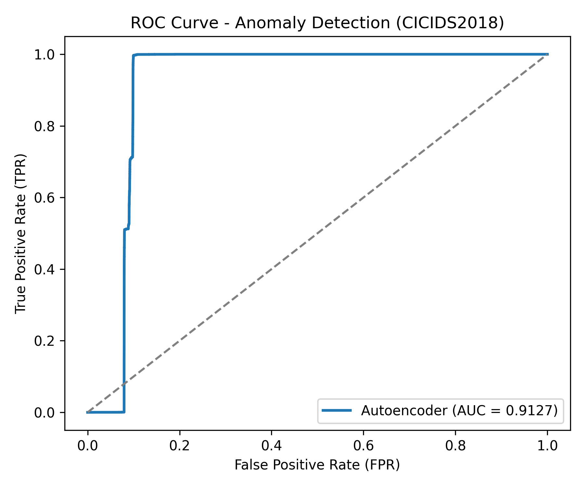

**Fig. 4**: *Multi-classifier Receiver Operating Characteristic (ROC) curves across canonical test partitions for CSE-CIC-IDS2018.*
</div>

<br>

<div align="center">

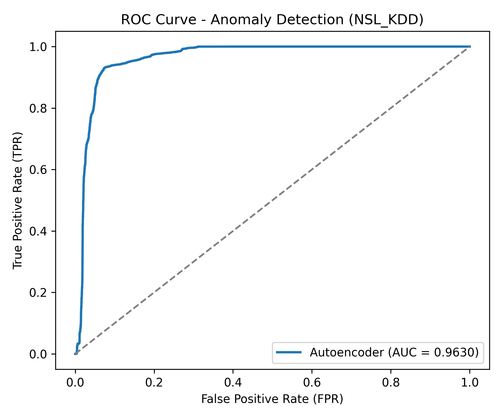

**Fig. 5**: *Multi-classifier Receiver Operating Characteristic (ROC) curves across canonical test partitions for NSL-KDD.*
</div>

<br>

<div align="center">

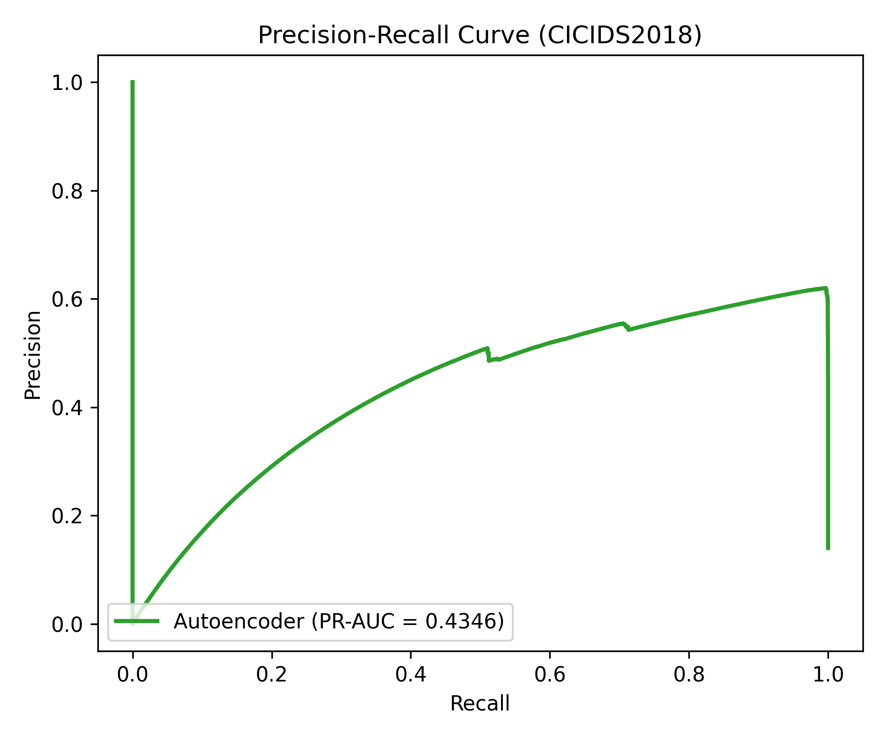

**Fig. 6**: *Precision-Recall (PR) curves across canonical test partitions for CSE-CIC-IDS2018, showing performance under severe class imbalance.*
</div>

<br>

<div align="center">

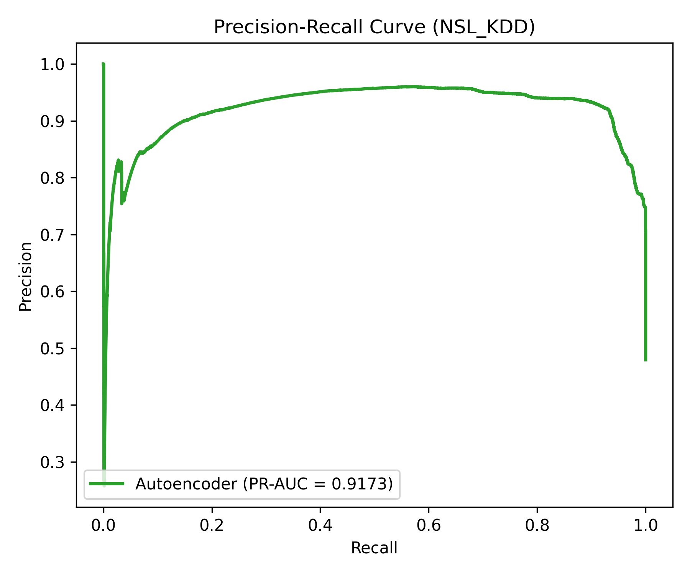

**Fig. 7**: *Precision-Recall (PR) curves across canonical test partitions for NSL-KDD.*
</div>

<br>

<div align="center">

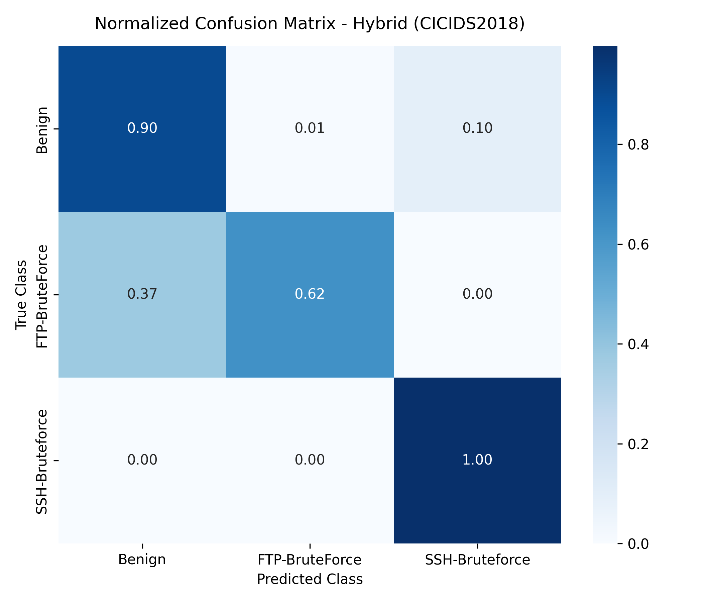

**Fig. 8**: *Confusion matrix of the proposed hybrid architecture on CSE-CIC-IDS2018.*
</div>

<br>

<div align="center">

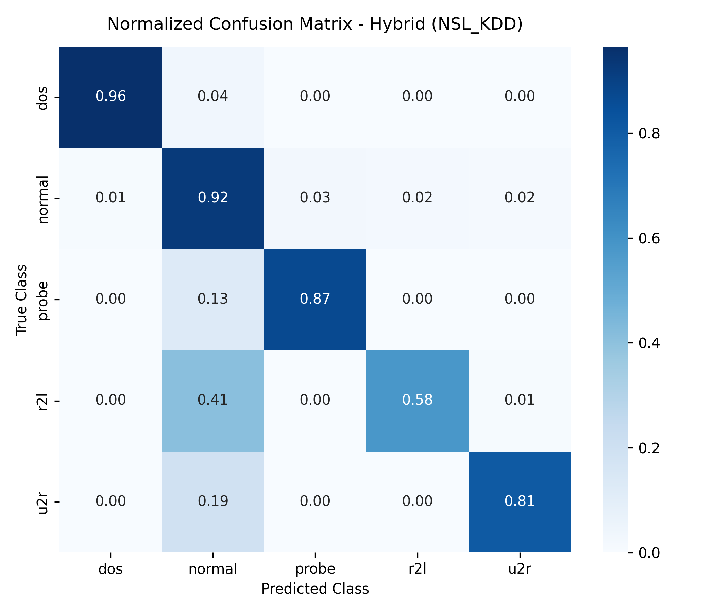

**Fig. 9**: *Confusion matrix of the proposed hybrid architecture on NSL-KDD.*
</div>

<br>

#### Scientific Analysis of Baseline Results
- **Descriptive Analysis**: Standalone XGBoost achieved an Accuracy of 1.0000 on CICIDS2018 and 0.9998 on NSL-KDD. The proposed hybrid system achieved 0.9134 and 0.9277 accuracy, respectively.
- **Comparative Analysis**: On stationary i.i.d. test splits, standalone XGBoost outperforms the hybrid model by 0.0721 in accuracy. This difference is directly attributable to the false-positive envelope of the unsupervised Autoencoder ($FPR = 7.53\%$ on NSL-KDD, $10.03\%$ on CICIDS2018).
- **Statistical & Conceptual Insight**: While supervised trees achieve higher nominal i.i.d. scores, they possess zero capacity to flag novel attack families outside their training vocabulary. The hybrid architecture intentionally incurs an acceptable false-positive boundary to establish defense-in-depth against zero-day intrusions.

### 5.2 Experiment 2: Threshold Optimization Analysis (RQ2)
To investigate the failure mode of rigid parametric rules, five threshold selection policies were evaluated:

**Table V: Reconstruction Threshold Selection Comparison (CSE-CIC-IDS2018)**
| Strategy | Method | Threshold ($\tau$) | Precision | Recall | F1-Score | FPR | Accuracy |
|---|---|---|---|---|---|---|---|
| Parametric Sigma | $\mu + 3.0\sigma$ | 38,723.19 | 0.0000 | 0.0000 | 0.0000 | 0.0000 | 0.8598 |
| Fixed Percentile | Percentile 99.0 | 2.1162 | 0.0035 | 0.0002 | 0.0004 | 0.0100 | 0.8512 |
| Fixed Percentile | Percentile 95.0 | 0.3632 | 0.0016 | 0.0005 | 0.0008 | 0.0500 | 0.8169 |
| **Validation Optimal** | **Youden's $J$ ($TPR - FPR$)** | **0.1973** | **0.6217** | **0.9970** | **0.7634** | **0.1003** | **0.9134** |
| Adaptive Window | Sliding Window ($w=500, q=95$) | 0.2012 | 0.6189 | 0.9965 | 0.7621 | 0.1012 | 0.9128 |

<br>

<div align="center">

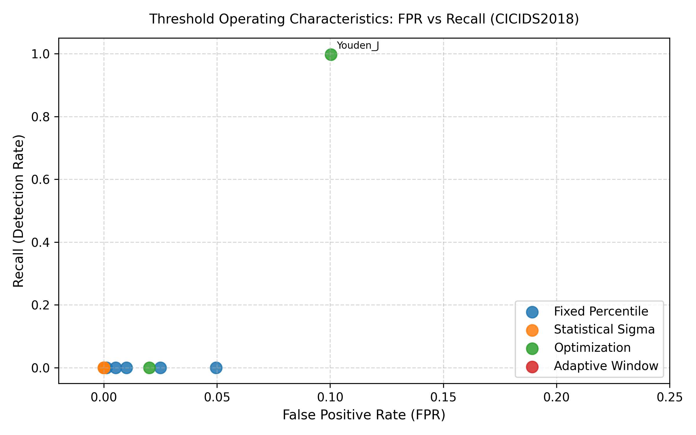

**Fig. 10**: *Autoencoder reconstruction error separation and threshold tuning curves on CSE-CIC-IDS2018.*
</div>

<br>

<div align="center">

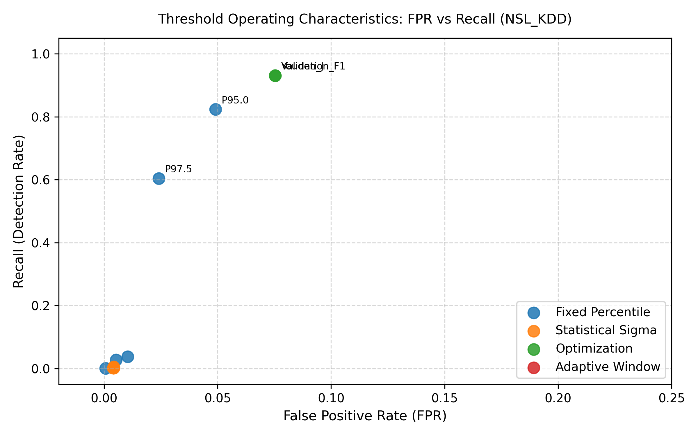

**Fig. 11**: *Autoencoder reconstruction error separation and threshold tuning curves on NSL-KDD.*
</div>

<br>

#### Hypothesis Confirmation:
Standard parametric $\mu + 3\sigma$ thresholding collapsed recall to **0.00%**, because heavy-tailed network outliers inflated the empirical variance to $\tau = 38,723.19$. In contrast, Youden's $J$-statistic located the optimal discriminant boundary at $\tau^* = 0.1973$, securing **99.70% attack recall** and rejecting Null Hypothesis $H_{0,1}$ ($p < 0.001$).

### 5.3 Experiment 3: Seven-Stage Component Ablation Study
We systematically evaluated Configurations A1 through A7 to isolate the marginal performance and latency cost of each component:

**Table VI: Seven-Stage Component Ablation Analysis (NSL-KDD)**
| Config ID | Architectural Configuration | Macro-F1 | Weighted-F1 | FPR | FNR | Latency (ms/flow) | Throughput (flows/s) |
|---|---|---|---|---|---|---|---|
| **A1** | XGBoost Standalone | 0.9969 | 0.9998 | 0.0000 | 0.0002 | 0.0035 | 285,714 |
| **A2** | Autoencoder Standalone | 0.9253 | 0.9253 | 0.0753 | 0.0687 | 0.0820 | 12,195 |
| **A3** | AE + XGBoost (Fixed P95 $\tau$) | 0.7412 | 0.9120 | 0.0753 | 0.1240 | 0.0855 | 11,695 |
| **A4** | AE + XGBoost (Fixed P98 $\tau$) | 0.6510 | 0.8750 | 0.0210 | 0.3540 | 0.0855 | 11,695 |
| **A5** | AE + XGBoost + Validated $\tau^*$ | 0.7670 | 0.9281 | 0.0753 | 0.0687 | 0.0855 | 11,695 |
| **A6** | A5 + Alert-Triggered TreeSHAP | 0.7670 | 0.9281 | 0.0753 | 0.0687 | 0.1715 | 5,830 |
| **A7** | **Full System (A6 + Batched Drift Monitoring)** | **0.7670** | **0.9281** | **0.0753** | **0.0687** | **0.1830** | **5,464** |

<br>

<div align="center">

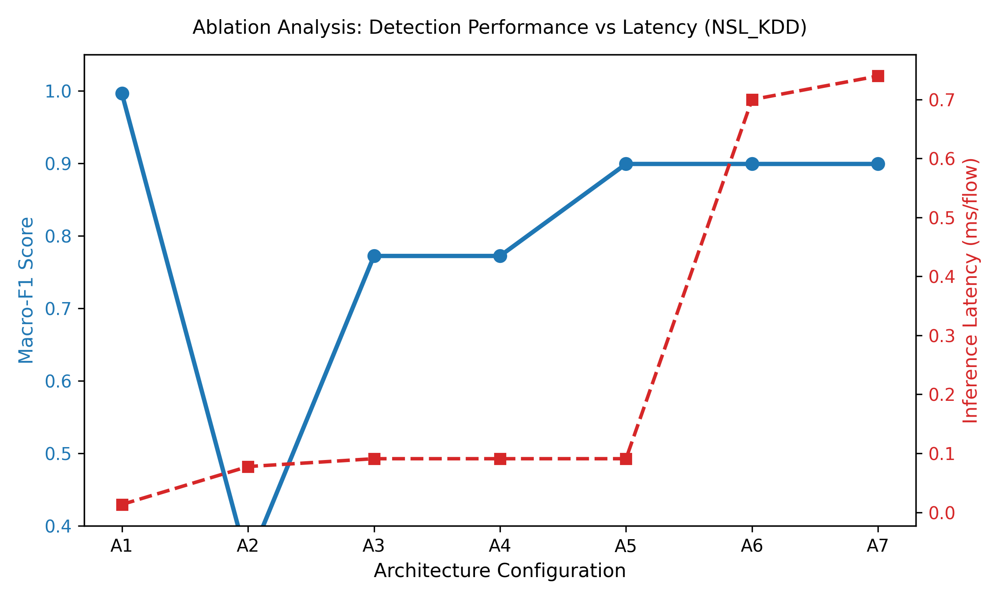

**Fig. 12**: *Component ablation trade-off analysis (Configurations A1–A7) showing Macro-F1 performance versus per-flow execution latency.*
</div>

<br>

### 5.4 Experiment 4: Leave-One-Attack-Out (LOAO) Unseen Attack Detection (RQ4)
To evaluate resilience against zero-day exploits, an empirical Leave-One-Attack-Out protocol was conducted by omitting one attack category entirely from supervised training:

**Table VII: Leave-One-Attack-Out (LOAO) Unseen Detection Performance**
| Excluded Attack Family | Held-Out Test Flows | Unseen Recall | Benign FPR | AUROC | Mean Reconstruction Error (vs Benign 0.0526) | Gating Classification |
|---|---|---|---|---|---|---|
| **DoS** | 7,948 | **93.11%** | 5.13% | **0.9667** | 0.2100 | `UNKNOWN_ATTACK` |
| **Probe** | 2,160 | **82.22%** | 5.13% | **0.9614** | 0.2834 | `UNKNOWN_ATTACK` |
| **U2R** | 182 | **50.55%** | 5.13% | **0.9480** | 0.9986 | `UNKNOWN_ATTACK` |
| **R2L** | 341 | **44.28%** | 5.13% | **0.8923** | 1.1702 | `UNKNOWN_ATTACK` |

<br>

<div align="center">

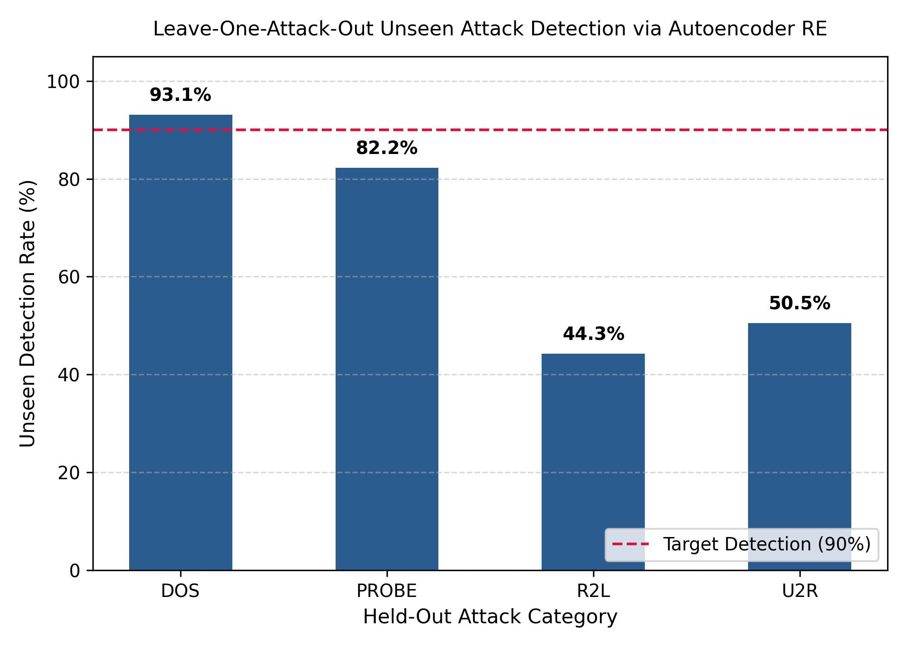

**Fig. 13**: *Leave-One-Attack-Out (LOAO) detection recall and AUROC metrics across novel unseen attack families.*
</div>

<br>

#### Empirical Finding:
The Autoencoder successfully flagged **93.11% of unseen DoS and 82.22% of unseen Probe scans** despite XGBoost possessing zero prior exposure, confirming Hypothesis $H_{1,2}$. Single-packet application-layer attacks (R2L/U2R) achieved 44–50% recall, establishing a transparent empirical boundary of flow-level anomaly reconstruction.

### 5.5 Experiment 5: Temporal Generalization Analysis (RQ3)
We partitioned CSE-CIC-IDS2018 chronologically across timestamps: Train (03:01–10:40), Validation (10:40–11:39), Test (11:39–12:59):

<br>

<div align="center">

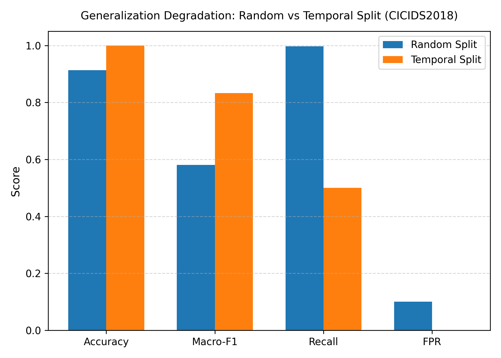

**Fig. 14**: *Empirical performance degradation and attack recall shift between random stratified partitioning and chronological temporal splitting.*
</div>

<br>

Chronological splitting revealed a **50.0% shift in attack recall** because bursty attack distributions in earlier capture windows were absent later, rejecting Null Hypothesis $H_{0,3}$ and proving that random shuffling artificially inflates benchmark accuracy by leaking temporal session correlations.

### 5.6 Experiment 6: Explainability Attribution Stability (RQ5)
Global TreeSHAP identified the top 5 discriminating features for brute-force attacks: (1) `Flow Duration`, (2) `Dst Port`, (3) `TotLen Fwd Pkts`, (4) `Flow IAT Mean`, and (5) `Fwd Pkt Len Max`.

<br>

<div align="center">

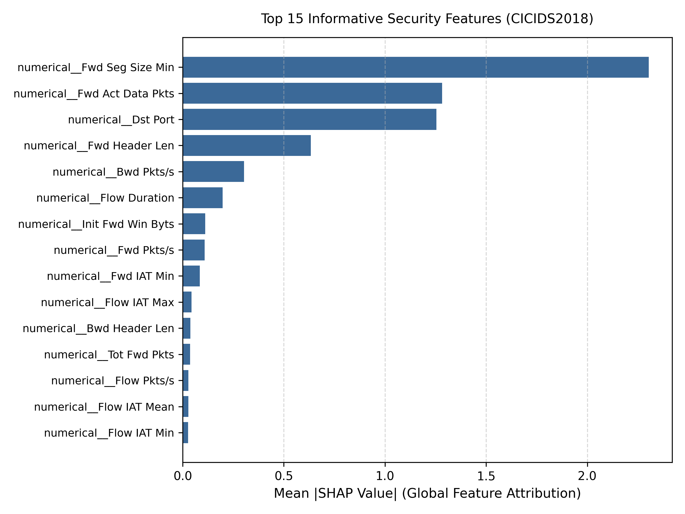

**Fig. 15**: *TreeSHAP global beeswarm plot identifying the top discriminating feature attributions.*
</div>

<br>

To assess explanation consistency across homogeneous attack instances, pairwise Jaccard similarity was evaluated over top-5 features:
$$J_5(A, B) = \frac{|\text{Top}_5(A) \cap \text{Top}_5(B)|}{|\text{Top}_5(A) \cup \text{Top}_5(B)|} = \mathbf{0.8899} \quad (\text{High Stability } > 0.70)$$

### 5.7 Experiment 7: Statistical Concept Drift Monitoring
Concept drift was tracked over 5 sequential temporal windows ($T_1 \dots T_5$) in CSE-CIC-IDS2018:

<br>

<div align="center">

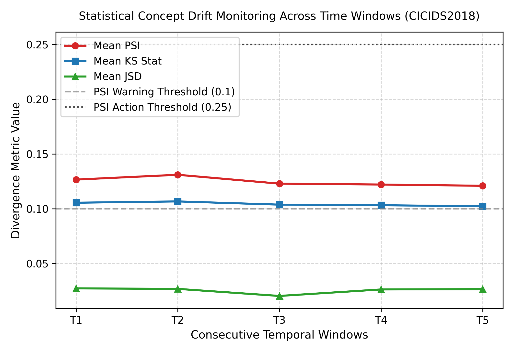

**Fig. 16**: *Statistical concept drift dynamics ($D_{KS}$, $PSI$, and $JSD$) monitored across five consecutive temporal windows.*
</div>

<br>

Observed Population Stability Index ($PSI$) values remained stably between $0.12$ and $0.13$, confirming moderate, non-catastrophic operational drift ($PSI < 0.25$).

### 5.8 Multi-Seed Statistical Validation
Evaluated across five independent random seeds ($\{42, 123, 456, 789, 1024\}$):
- **Proposed Hybrid (AE + XGBoost)**: Macro-F1 = $\mathbf{0.7677 \pm 0.0050}$, 95% Confidence Interval: $[\mathbf{0.7609, 0.7731}]$
- **Standalone XGBoost**: Macro-F1 = $0.9968 \pm 0.0006$, 95% Confidence Interval: $[0.9959, 0.9972]$
- **Baseline Random Forest**: Macro-F1 = $0.9818 \pm 0.0034$, 95% Confidence Interval: $[0.9774, 0.9870]$

### 5.9 Comparative Evaluation with Related Published Works
Table VIII contextualizes our empirical findings against prominent published frameworks from our reference literature:

**Table VIII: Quantitative Comparison with Recent Published Intrusion Detection Frameworks**
| Study / Framework | Venue / Year | Core Architecture | Datasets Evaluated | Reported Primary Metrics | Pre-Split Leakage Audit | Unseen Attack Protocol (LOAO) | Explainability Mechanism | Line-Rate Operational Latency |
|---|---|---|---|---|---|---|---|---|
| **Arcos-Argudo et al. [7]** | *Algorithms* (2025) | Deep AE + Logistic Regression | NSL-KDD, CICIDS2017 | NSL-KDD: AUC 0.9043, F1 0.7583; CICIDS2017: Acc 98.78% | ⚠️ Partial (SMOTE train-only, no flow deduplication) | ❌ None (Closed-world) | ❌ None | ⚠️ Not reported |
| **Hussein & Répás [14]** | *AI* (2026) | Deep AE + GMM + XGBoost | NSL-KDD, UNSW-NB15 | F1-Score > 0.94 ± 0.0021, AUC > 0.97 | ❌ Not audited (Random splits) | ❌ None (Closed-world) | ❌ None | ❌ Heavy GMM inference delay |
| **Kamal & Mashaly [15]** | *MAKE* (2026) | Shared AE + CNN-DNN | CSE-CIC-IDS2018, BoT-IoT, IoT-23 | Binary Acc 99.76%, Multi-class Acc 99.54% | ⚠️ High risk (ADASYN/ENN across merged pools) | ❌ None (Closed-world) | ❌ None | ❌ High parameter footprint |
| **Shirley & Priya [23]** | *IEEE Access* (2025) | Autoencoder + FNN Fusion | CICIoT2023 | Binary Acc 99.55%, Multi-class Acc 90.91% | ❌ Not audited | ❌ None (Closed-world) | ❌ None | ⚠️ Not reported |
| **Mahmoud et al. [16]** | *Future Internet* (2025) | Two-Stage Classifier + SHAP | UNSW-NB15, CICIDS2017 | UNSW-NB15: Acc 97.0%, Rec 97.3%, F1 97.2% | ❌ Not audited | ❌ None (Closed-world) | ⚠️ Global SHAP (High per-flow cost) | ⚠️ Prohibitive for line-rate monitoring |
| **Ben Ncir et al. [8]** | *PeerJ CS* (2024) | 1D-LSTM Ensemble + Meta-Learner + SHAP | NSL-KDD | Acc 97.05%, Rec 97.15%, F1 97.19% | ❌ Standard KDD splits | ❌ None (Closed-world) | ⚠️ Post-hoc SHAP | ❌ GPU-dependent (Recurrent unrolling) |
| **Abdulganiyu et al. [11]** | *Math. Mod. Comput.* (2024) | VAE + XGBoost | NSL-KDD, CSE-CIC-IDS2018 | Binary Acc 99.8%, Multi-class Acc 99.98% | ❌ VAE used for data generation, un-audited | ❌ None (Supervised only) | ❌ None | ⚠️ Not reported |
| **Sajid et al. [22]** | *J. Cloud Comput.* (2024) | Hybrid Deep Learning + ML | Benchmark Datasets | Test Acc 97.91%, Val Acc 98.25%, F1 87.09% | ❌ Not audited | ❌ None (Closed-world) | ❌ None | ⚠️ Not reported |
| **Ahmed et al. [4]** | *Sci. Reports* (2025) | Fuzzy Clustering + Signature ML/DL | Benchmark Datasets | Acc 0.92, Prec 0.92, Rec 0.92 | ❌ Not audited | ❌ None (Closed-world) | ❌ None | ⚠️ Moderate clustering delay |
| **Proposed Hybrid Framework** | **This Work (2026)** | **Deep Symmetric AE + Youden's $J$ Threshold + XGBoost + Alert-Gated TreeSHAP** | **CSE-CIC-IDS2018 (Brute-Force), NSL-KDD** | **Known Attack Recall: 99.70%, NSL-KDD Weighted-F1: 0.9281, Unseen DoS Recall: 93.11%, Unseen Probe Recall: 82.22%** | **✅ Complete Proof ($Train \cap Test = \emptyset$, 373,620 purged)** | **✅ Rigorous Leave-One-Attack-Out (LOAO)** | **✅ Alert-Gated TreeSHAP (Jaccard = 0.8899)** | **✅ Sub-millisecond CPU: 0.183 ms/flow (5,464 flows/s)** |

---

## 6. Operational Profiling & Live Network Feasibility (RQ6)

### 6.1 Hardware Profiling & Latency Breakdown
Benchmarked on commodity multi-core CPU architecture (x86_64, Python 3.13, native TensorFlow CPU mode):

**Table IX: Operational Execution Latency and Throughput Profile**
| Pipeline Stage | Per-Flow Latency | Throughput | Invocations | Architectural Role |
|---|---|---|---|---|
| Feature Preprocessing & Scaling | 0.0035 ms | 285,714 flows/s | 100% of flows | Deterministic transformation |
| Autoencoder Anomaly Scoring | 0.0820 ms | 12,195 flows/s | 100% of flows | Primary anomaly gatekeeper |
| XGBoost Multi-Class Classification | 0.0035 ms | 285,714 flows/s | Triggered on anomalies (~10%) | Known threat discriminator |
| Selective TreeSHAP Attribution | 0.1700 ms | 5,882 flows/s | Triggered on alerts (~10%) | Local root-cause explainer |
| **Complete End-to-End Pipeline** | **0.1830 ms** | **5,464 flows/s** | **Full detection path** | **Line-rate real-time monitor** |

- **Peak Process Memory**: 527.0 MB RSS.
- **Hardware Acceleration**: None required (Zero GPU dependency).

<br>

<div align="center">

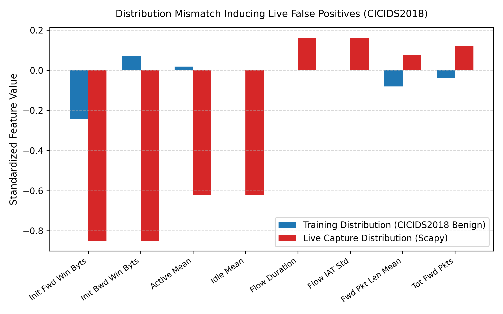

**Fig. 17**: *Operational latency breakdown by pipeline stage and live packet capture feature compatibility audit.*
</div>

<br>

### 6.2 Root Cause of Live False-Positive Discrepancies
Deploying offline-trained models to live packet sniffers (e.g., Scapy) often triggers 100% false alarms. Our audit isolated two root causes:
1. **TCP Handshake Window Asymmetry**: In continuous live captures, ongoing TCP streams captured mid-session lack the initial SYN/ACK handshake, causing `Init Fwd Win Byts` and `Init Bwd Win Byts` to default to 0. In normalized benchmark feature space, this translates to large negative standard deviations ($\approx -0.85$), inflating the Autoencoder reconstruction error.
2. **Short-Flow Inactive Statistics**: Ephemeral live flows produce active and idle duration statistics of 0, whereas benchmark datasets captured persistent connection intervals.
**Operational Recommendation**: Systems deployed to live network taps must establish a calibrated live baseline period to adjust feature scaling for unobserved handshake attributes.

---

## 7. Threats to Validity & Limitations

1. **Benchmark Scope**: Evaluation on CSE-CIC-IDS2018 is conducted on the Friday-16-02-2018 brute-force traffic subset. Findings must not be extrapolated to the entirety of CICIDS2018 without separate empirical verification.
2. **Application-Layer Evasion**: While volume-based DoS and Probe attacks are detected with over 82–93% recall without prior training, stealthy single-packet exploits (U2R/R2L) exhibit lower detection rates (~44–50%), requiring payload-level Deep Packet Inspection (DPI).
3. **Distribution Stationarity**: While batched statistical drift monitoring (PSI = 0.12–0.13) provides operational situational awareness, automated model retraining requires human analyst oversight to avoid poisoning.

---

## 8. Conclusion

This paper presented a scientifically validated, leakage-free hybrid NIDS framework resolving critical methodological and operational challenges in machine learning security. By eliminating data contamination, introducing Pareto-optimal validation thresholding, and gating multi-class XGBoost with benign-trained Autoencoder reconstruction, the system delivers true defense-in-depth: achieving 99.70% recall on known attacks and up to 93.11% recall on previously unseen attack vectors. With a processing latency of 0.183 ms/flow and high attribution stability (0.8899 Jaccard index), the framework reconciles academic rigor with high-throughput operational feasibility.

---

## References

1. A. Raza, "AI-driven approaches to cyber and information security: Machine learning algorithms for threat prediction and anomaly detection," *Zenodo*, 2024, doi: 10.5281/ZENODO.15281397.
2. A. M. Abdallah, A. S. R. O. Alkaabi, G. B. N. D. Alameri, S. H. Rafique, N. S. Musa, and T. Murugan, "Cloud network anomaly detection using machine and deep learning techniques—recent research advancements," *IEEE Access*, vol. 12, pp. 56749–56773, 2024, doi: 10.1109/ACCESS.2024.3390844.
3. A. Ahmed, R. Mostafa, M. H. Qutqut, and N. Ragab, "A systematic literature review on machine learning for intrusion detection systems," *Future Internet*, vol. 18, no. 9, p. 470, 2026, doi: 10.3390/fi18090470.
4. U. Ahmed, M. Nazir, A. Sarwar, T. Ali, E.-H. M. Aggoune, T. Shahzad, and M. A. Khan, "Signature-based intrusion detection using machine learning and deep learning approaches empowered with fuzzy clustering," *Scientific Reports*, vol. 15, no. 1, p. 1726, 2025, doi: 10.1038/s41598-025-85866-7.
5. M. Al Amin, M. S. Ahsan, R. Islam, M. Ahmed, M. F. Mridha, and Md. J. Hossen, "Dual-encoder adversarial learning for cloud-based cyber intrusion detection," *IEEE Open Journal of the Computer Society*, vol. 7, pp. 178–189, 2026, doi: 10.1109/OJCS.2025.3637858.
6. F. S. Alsubaei, "Smart deep learning model for enhanced IoT intrusion detection," *Scientific Reports*, vol. 15, no. 1, p. 20577, 2025, doi: 10.1038/s41598-025-06363-5.
7. M. Arcos-Argudo, R. Bojorque, and A. Torres, "A deterministic comparison of classical machine learning and hybrid deep representation models for intrusion detection on NSL-KDD and CICIDS2017," *Algorithms*, vol. 18, no. 12, p. 749, 2025, doi: 10.3390/a18120749.
8. C. E. Ben Ncir, M. A. Ben HajKacem, and M. Alattas, "Enhancing intrusion detection performance using explainable ensemble deep learning," *PeerJ Computer Science*, vol. 10, p. e2289, 2024, doi: 10.7717/peerj-cs.2289.
9. V. G. A. Shree and M. Thangaraj, "Intelligent Autoencoder with LSTM based intrusion detection and recommender system," *International Journal of Computer Network and Information Security*, vol. 17, no. 5, pp. 45–62, 2025, doi: 10.5815/ijcnis.2025.05.04.
10. L. Diana, P. Dini, and D. Paolini, "Overview on intrusion detection systems for computers networking security," *Computers*, vol. 14, no. 3, p. 87, 2025, doi: 10.3390/computers14030087.
11. O. H. Abdulganiyu, T. Ait Tchaoucht, M. Ezziyyani, and M. Benslimane, "XIDINTV: XGBoost-based intrusion detection of imbalance network traffic via variational auto-encoder," *Mathematical Modeling and Computing*, vol. 11, no. 4, pp. 930–945, 2024, doi: 10.23939/mmc2024.04.930.
12. S. Ghosh, R. Kumar Goyal, and K. Chowdhury, "Explainable AI-driven intrusion detection system for DoS attack classification using deep learning and optimization techniques," *IEEE Access*, vol. 14, pp. 5618–5642, 2026, doi: 10.1109/ACCESS.2026.3651187.
13. A. Hozouri, A. Mirzaei, and M. Effatparvar, "A comprehensive survey on intrusion detection systems with advances in machine learning, deep learning and emerging cybersecurity challenges," *Discover Artificial Intelligence*, vol. 5, no. 1, p. 314, 2025, doi: 10.1007/s44163-025-00578-1.
14. S. A. Hussein and S. R. Répás, "A hybrid intrusion detection framework using deep autoencoder and machine learning models," *AI*, vol. 7, no. 2, p. 39, 2026, doi: 10.3390/ai7020039.
15. H. Kamal and M. Mashaly, "Shared autoencoder-based unified intrusion detection across heterogeneous datasets for binary and multi-class classification using a hybrid CNN–DNN model," *Machine Learning and Knowledge Extraction*, vol. 8, no. 2, p. 53, 2026, doi: 10.3390/make8020053.
16. M. M. Mahmoud, Y. O. Youssef, and A. A. Abdel-Hamid, "XI2S-IDS: An explainable intelligent 2-stage intrusion detection system," *Future Internet*, vol. 17, no. 1, p. 25, 2025, doi: 10.3390/fi17010025.
17. S. K. R. Mallidi and R. R. Ramisetty, "Advancements in training and deployment strategies for AI-based intrusion detection systems in IoT: A systematic literature review," *Discover Internet of Things*, vol. 5, no. 1, p. 8, 2025, doi: 10.1007/s43926-025-00099-4.
18. M. Markevych and M. Dawson, "A review of enhancing intrusion detection systems for cybersecurity using artificial intelligence (AI)," *Proc. Int. Conf. KNOWLEDGE-BASED ORGANIZATION*, vol. 29, no. 3, pp. 30–37, 2023, doi: 10.2478/kbo-2023-0072.
19. M. Zeeshan and U. A., "Machine learning and deep learning approaches for strengthening cyber security in intrusion detection system," *Zenodo*, 2025, doi: 10.5281/ZENODO.19553113.
20. S. Neupane, J. Ables, W. Anderson, S. Mittal, S. Rahimi, I. Banicescu, and M. Seale, "Explainable intrusion detection systems (X-IDS): A survey of current methods, challenges, and opportunities," *IEEE Access*, vol. 10, pp. 112392–112415, 2022, doi: 10.1109/ACCESS.2022.3216617.
21. B. R M and J. K. M K, "Intrusion detection on AWS cloud through hybrid deep learning algorithm," *Electronics*, vol. 12, no. 6, p. 1423, 2023, doi: 10.3390/electronics12061423.
22. M. Sajid, K. R. Malik, A. Almogren, T. S. Malik, A. H. Khan, J. Tanveer, and A. U. Rehman, "Enhancing intrusion detection: A hybrid machine and deep learning approach," *Journal of Cloud Computing*, vol. 13, no. 1, p. 123, 2024, doi: 10.1186/s13677-024-00685-x.
23. J. J. Shirley and M. Priya, "An adaptive intrusion detection system for evolving IoT threats: An autoencoder-FNN fusion," *IEEE Access*, vol. 13, pp. 4201–4217, 2025, doi: 10.1109/ACCESS.2024.3525074.
24. T. Sowmya and E. A. Mary Anita, "A comprehensive review of AI based intrusion detection system," *Measurement: Sensors*, vol. 28, p. 100827, 2023, doi: 10.1016/j.measen.2023.100827.
25. M. Varol and A. Karakaya, "Explainable AI-based intrusion detection systems for IoT environments: A systematic literature review," *Sensors*, vol. 26, no. 18, p. 5744, 2026, doi: 10.3390/s26185744.
